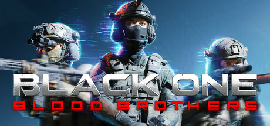

**Black One Blood Brothers is an elite tactical shooter focused on squad-based ops with a lethal one-shot realism model.**

---

## 📖 About

Black One Blood Brothers is an elite tactical shooter focused on squad-based ops with a lethal one-shot realism model. You command a team through hostile environments with limited intel, relying on coordination, suppression, and precision to survive.

## ⚠️ Problems Without Trainer

| Problem | Status |
|---------|--------|
| Single enemy hit kills squad members without heavy armor investment | ✅ Solved |
| Intel scarcity forces blind entries into rooms with multiple armed contacts | ✅ Solved |
| Team AI pathfinding fails in complex indoor geometries losing suppressive fire | ✅ Solved |
| Mission supply limits prevent carrying enough ammunition for extended fights | ✅ Solved |
| Extraction failures on team wipe reset entire mission progress to start | ✅ Solved |

## ✅ Solution

The **Black One Blood Brothers Trainer** solves all these issues, giving you complete control so you can focus on enjoying the game.

## 🎯 Features

- Unlimited Resources / Currency
- God Mode / Invincibility
- Instant Skill & Ability Cooldown
- One-Hit Kill
- Freeze Timers
- Unlock All Items & Achievements
- Custom Speed Multiplier
- Infinite Stamina / Energy

## 🚀 Quick Start

1. **Disable Windows Defender** temporarily (trainer may trigger false positive)
2. Get the trainer from the button above
3. Launch Black One Blood Brothers
4. Run the trainer as Administrator
5. Use the hotkeys to activate cheats in-game

## 💎 Free vs Pro

| Feature | Free | Pro |
|---------|------|-----|
| God Mode | ✅ | ✅ |
| Unlimited Resources | ✅ | ✅ |
| Advanced Cheats | ❌ | ✅ |
| Auto-Updates | ❌ | ✅ |
| Priority Support | ❌ | ✅ |

## 💻 Requirements

- Windows 10 / 11 (64-bit)
- Black One Blood Brothers (any version)
- .NET Framework 4.8+
- DirectX 11+

## 🍎 macOS

## ⚖️ Legal

Educational and single-player use only.

---

